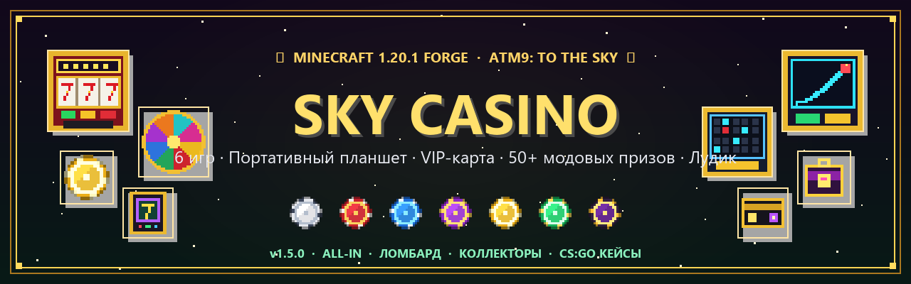
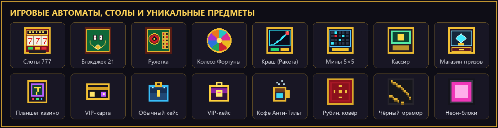

<div align="center">



<br />

[](https://www.minecraft.net/)
[](https://files.minecraftforge.net/)
[](https://www.curseforge.com/minecraft/modpacks/all-the-mods-9-to-the-sky)
[](https://github.com/raiyaxkrash/SkyCasino/releases/latest)
[](#)
[](#)

<p>
  <b>Полноценный мод на роскошное казино для Minecraft 1.20.1 (Forge) и ATM9: To the Sky.</b><br />
  6 азартных игр · Портативный планшет · VIP-карта · 50+ модовых призов и CS:GO-кейсы · Хардкорная механика Лудика.
</p>

[🎲 Игры](#-игры-казино) · [📱 Портативность и Экономика](#-экономика-vip-карта-и-портативность) · [🎁 Призы и Кейсы](#-магазин-призов-и-луд-кейсы) · [🔥 Механика Лудика](#-хардкорная-механика-лудика) · [🏛️ Декор](#️-люксовый-декор-казино) · [📦 Установка](#-установка)

</div>

---

<div align="center">
  
</div>

---

## 🎲 Игры казино

Все игры работают **сервер-авторитетно** (через защищённые сетевые пакеты Forge `SimpleChannel` — без возможности читерить в мультиплеере), сопровождаются анимациями, звуками, салютом из частиц при крупных выигрышах и поддерживают кнопку **`ALL-IN`** (поставить весь банк в 1 клик, до `10 000 000` фишек).

| Игра | Блок / Планшет | Механика | Макс. множитель |
| :--- | :---: | :--- | :---: |
| **🎰 Игровой автомат 777** | `slot_machine` | 3×3 барабана с поочерёдной остановкой, 5 линий выплат (3 горизонтали + 2 диагонали), таблица выплат | **`×50`** (7-7-7) |
| **🃏 VIP Блэкджек (21)** | `blackjack_table` | Реальные карты с мастями (`♠ ♥ ♦ ♣`), `Ещё` / `Хватит` / `×2 (Double Down)`, дилер добирает до 17 | **`×2.5`** (Натуральный 21) |
| **🎡 Европейская Рулетка** | `roulette_table` | Вращающаяся лента `0–36`, Красное/Чёрное, Чёт/Нечет, 1–18/19–36, Дюжины (`×3`), Зеро и точное число, история | **`×36`** (Точное число) |
| **🎯 Колесо Фортуны** | `fortune_wheel` | 12 цветных секторов с физическим замедлением вращения и золотой стрелкой | **`×25`** (ДЖЕКПОТ) |
| **🚀 Краш — Ракета** | `crash_machine` | Живой график роста множителя, успей нажать **«ЗАБРАТЬ!»**, пока ракета не взорвалась | **`×50.00`** |
| **💣 Мины 5×5** | `mines_machine` | Выбирай `3 / 5 / 10 / 15` мин, открывай клетки с алмазами, умножая банк, и забирай в любой момент | **Экспоненциальный** |

---

## 📱 Экономика, VIP-карта и Портативность

### 🪙 7 номиналов фишек
`Белая (1)` · `Красная (5)` · `Синяя (25)` · `Фиолетовая (100)` · `Золотая VIP (1 000)` · `Изумрудная мега (10 000)` · `Звёздная мега (100 000)`

### 💳 VIP-карта казино (`vip_card`)
- Хранит **неограниченный баланс** фишек в NBT на одном предмете (с переливанием зачарования при положительном балансе).
- Все ставки и выигрыши **автоматически** списываются с карты и зачисляются на неё — инвентарь никогда не захламляется стаками фишек.
- **ПКМ** с картой в руке мгновенно переносит все физические фишки из инвентаря на карту.

### 📱 Портативный планшет казино (`pocket_casino`)
- Открывает стильный **VIP-хаб** прямо из руки (**ПКМ**) в любой точке твоего скайблок-острова.
- Мгновенный доступ ко **всем 6 играм**, **Кассирскому терминалу**, **Магазину призов** и **Кабинету Лудика**.

### 🏦 Кассирский терминал (`cashier_terminal`)
- Обмен ванильных и модовых ресурсов на фишки и **обратный вывод (Кэшаут)** в 1 клик (`+1`, `+10`, `Всё` / `-1`, `-10`, `Max`).
- Кнопка автоматического укрупнения фишек / перевода на VIP-карту.

---

## 🎁 Магазин призов и Луд-кейсы

- **Магазин призов (`prize_shop`)** — 3D-витрина с переключением страниц (`<` / `>`), где выигранные фишки можно тратить на редкие ванильные и модовые предметы (Тотемы, Элитры, Маяки, Шалкеры и десятки легендарных предметов из модов).
- **Обычный и VIP Луд-кейсы (`loot_case_classic`, `loot_case_vip`)** — полноценная **CS:GO-рулетка открытия кейсов** с плавным замедлением, щелчками карточек и 5 уровнями редкости:
  > 🔵 **Обычный** → 🔷 **Редкий** → 🟣 **Эпический** → 🌸 **Легендарный** → ⭐ **МИФИЧЕСКИЙ ДРОП!**

<details>
<summary><b>🧩 Интеграция с 20+ популярными модами (нажми, чтобы раскрыть список)</b></summary>

> Все модовые предметы подхватываются **динамически из реестра Forge** — в твоей сборке автоматически появятся все установленные моды со своими иконками и названиями, без жёстких зависимостей и риска крашей.

- **Allthemodium & All The Tweaks:** Allthemodium / Vibranium / Unobtainium Ingots, Allthemodium Apple / Pickaxe / Sword, ATM Star Shard, **★ ATM Star ★**
- **Mekanism:** Osmium, Refined Obsidian, Atomic Alloy, Ultimate Control Circuit, Armored Jetpack, Atomic Disassembler, **MekaSuit Bodyarmor**, **Antimatter Pellet**, **Supermassive QIO Drive**
- **Create:** Brass Ingot, Precision Mechanism, Blaze Cake, Mechanical Arm, Extendo Grip, Potato Cannon
- **Botania:** Elementium, Terrasteel, Gaia Spirit Ingot, Blacker Lotus, Greater Band of Magnetization, Flugel Tiara
- **Ars Nouveau:** Source Gem, Apprentice & Archmage Spell Books, Ring of Greater Discount
- **Thermal Series & Ender IO:** Signalum, Lumium, Enderium, Vibrant Alloy, Resonant Integral Components, Octadic Capacitor, Staff of Travelling
- **Powah & Flux Networks:** Spirited & Nitro Crystals, Nitro Battery, Nitro Thermo Generator, Flux Core, Flux Controller
- **Industrial Foregoing & Draconic Evolution:** Pink Slime Ingot, Infinity Drill, Infinity Backpack, Draconium & Awakened Draconium, **Chaotic Core**
- **Хранение и утилиты:** AE2 (`64k` / `256k` Cells), Refined Storage (`64k Disk`, `Wireless Grid`), Sophisticated Backpacks (`Netherite Backpack`), Occultism (`Iesnium`, `Storage Remote`), Waystones (`Waystone`, `Warp Stone`), Building Gadgets (`Building` / `Copy-Paste`), Pipez (`Ultimate` / `Infinity Upgrade`), LaserIO (`Overclocker Node`), Time in a Bottle, Hostile Neural Networks (`Prediction Matrix`, `Simulation Chamber`)
- **Магия, пчёлы и скайблок:** Apotheosis (`Godforged Pearl`, `Gem Dust`), Productive Bees (`Omega Productivity Upgrade`), Mystical Agriculture (`Supremium`, `Insanium`, `Master Infusion Crystal`), Ex Deorum (`Diamond` / `Netherite Mesh`)

</details>

---

## 🔥 Хардкорная механика «Лудика»

> [!WARNING]
> **Осторожно!** В Sky Casino 1.5.0 азарт имеет реальные игровые последствия — от жирных бонусов до настоящих коллекторов с незеритовыми топорами.

| Механика | Как работает |
| :--- | :--- |
| **📉 Лудомания и Ломка** | Каждая ставка повышает Лудоманию (`0–100%`). Если не играть 2–3 минуты, начинается **Ломка**: усталость, голод, слабость, вспышки тошноты и *«Шёпот лудика»*. Снимается новой ставкой или **Кофе «Анти-Тильт»**. |
| **🏪 Ломбард при Ломке** | Во время Ломки в **Кабинете Лудика** открывается Ломбард: возьми в руку **любой предмет** (инструмент, броню, чареную или модовую вещь) и сдай его за мгновенные фишки! |
| **💸 Микрозайм + Коллекторы** | Займи `+1 000` / `+5 000` / `+25 000` фишек под `+25%`. Пока есть долг, **35%** выигрышей списывается на его погашение. Не вернёшь за **5 минут** — со звуком рейда придут **2–3 «Коллектора Казино»** в незеритовой броне! |
| **🔥 Горячая рука (Винстрик)** | **3+ победы подряд** дают огненную ауру, эффект Удачи и бонус к выплатам: **`+25%`** (3–4), **`+40%`** (5–6), **`+60%`** (7+ побед подряд)! |
| **💢 Жёсткий Тильт** | **3+ слива подряд** накрывают Тильтом (вспышка темноты, слабость, тошнота, стук сердца Вардена). |
| **☕ Кофе «Анти-Тильт»** | Крафтится из бутылочки, какао-бобов, сахара и золотого самородка — мгновенно снимает Ломку и Тильт, снижая Лудоманию на `35%`. |
| **🙏 Утешительный Додеп** | Если слил всё до `0`, раз в 10 минут можно нажать **«ДОДЕП»** и получить `100` фишек с мемным объявлением на весь сервер. |

### Команды
- `/ludik` — показать текущий статус Лудомании, серию побед, долг и статус Ломки.
- `/ludik lomka` *(OP)* — мгновенно включить Ломку для теста Ломбарда.

---

## 🏛️ Люксовый декор казино

Построй собственное здание казино на острове! Все блоки имеют крафты и дропаются при ломании:
- **Ковры:** Рубиново-золотой и Изумрудно-золотой ковры казино
- **Мрамор:** Белый мрамор с золотыми прожилками и Чёрный мрамор с золотом
- **Свет и неон:** Золотой, Розовый, Голубой и Изумрудный неоновые блоки (`light 15`), Светящаяся вывеска казино, Хрустальная люстра с частицами
- **Мебель:** Стойка казино из красного дерева и Бархатный табурет (на него можно **сесть ПКМ**!)

---

## 📦 Установка

1. Скачай готовый `skycasino-1.5.0.jar` со страницы [**Releases**](https://github.com/raiyaxkrash/SkyCasino/releases/latest).
2. Помести файл в папку `mods` твоей сборки **Minecraft 1.20.1 Forge** (например, **ATM9: To the Sky**).
3. Запускай игру — всё работает как в одиночном режиме, так и на сервере!

---

## 🛠️ Сборка из исходников

```bash
git clone https://github.com/raiyaxkrash/SkyCasino.git
cd SkyCasino
# Требуется JDK 17 и Gradle 8.8
gradle build
```
Готовый `.jar` появится в `build/libs/skycasino-1.5.0.jar`.

---

<div align="center">
  <sub>Сделано с ❤️ для <b>Minecraft 1.20.1 Forge & ATM9: To the Sky</b> · Лицензия MIT</sub>
</div>
